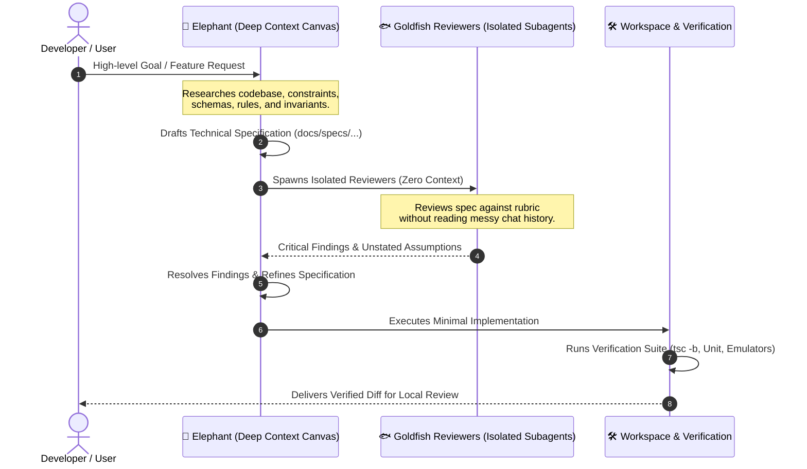

# Mysuru Paakashale ERP — Development & EGM Workflow

[← Back to Knowledge Base Hub](README.md) | [Project Context](PROJECT_CONTEXT.md) | [Business Rules](BUSINESS_RULES.md) | [Technical Architecture](TECHNICAL_ARCHITECTURE.md) | [Current Status](CURRENT_STATUS.md) | [Decisions (ADRs)](DECISIONS.md)

---

This document defines the development practices, testing standards, branching protocols, and the Elephant-Goldfish Model (EGM) methodology for the Mysuru Paakashale ERP project.

---

## 1. Development Methodology: Elephant-Goldfish Model (EGM)

All non-trivial feature development, refactorings, security fixes, and architectural adjustments follow the **Elephant-Goldfish Model (EGM)**:



### The Roles in EGM:
1. **The Elephant (Primary Session):**
   - Holds long-horizon project context: repository history, business rules, architectural constraints, and previous commits.
   - Author of [RFCs (Requests For Comments)](PROJECT_CONTEXT.md#acronym-glossary), technical specifications, and implementation diffs.
2. **The Goldfish (Fresh-Context Subagents):**
   - Independent subagents (`invoke_subagent`) launched without parent conversational history.
   - Evaluate specifications with unbiased, fresh eyes:
     - `egm-codebase-details`: Pedantic auditor verifying claims against actual source code and library reuse.
     - `egm-comprehension`: Naive reader flagging undefined acronyms and ambiguous requirements.
     - `egm-design`: Critical architect identifying unmitigated operational risks and scalability bottlenecks.
     - `egm-implementation-readiness`: Tech lead verifying execution instructions are unambiguous.

---

## 2. Git Branching & Lifecycle Standards

- **Base Branch:** `main` represents production-ready code. All work merges into `main` via GitHub Pull Requests.
- **Branch Naming Conventions:**
  - `feat/<feature-name>`: New user-facing or operational features.
  - `fix/<issue-name>`: Bug fixes and regression repairs (e.g. `fix/order-repository-emulator-test-fixture`).
  - `docs/<topic>`: Documentation and project context enhancements (e.g. `docs/egm-project-context-bootstrap`).
  - `refactor/<scope>`: Code cleanup with zero functional changes.
- **Merge Standard:**
  - Fast-forward or GitHub PR merge commits with clean linear history.
  - Local `main` must always be synchronized with `origin/main` before branching (`git merge --ff-only origin/main`).
  - Branches must never include unintended files or unrelated changes.

---

## 3. Strict Pre-Commit & Pre-PR Verification Pipeline

Before staging, committing, or opening a PR, the following verification pipeline must pass with **zero errors**:

| Seq | Stage | Exact Command | Success Criteria |
|---|---|---|---|
| **1** | **Whitespace & Format** | `git diff --check` | Exit code 0; zero whitespace or line-break warnings. |
| **2** | **Composite TypeScript** | `npm run type-check` *(Windows: `npm.cmd run type-check`)* | Exit code 0; clean build across all project tsconfigs (`app`, `node`, `int`). |
| **3** | **Lint Audit (Oxlint)** | `npm run lint` | Exit code 0; zero lint errors or unhandled warnings. |
| **4** | **Unit Test Suite** | `npm run test:unit`<br>*(Targeted: `npx vitest run <path/to/test.ts>`)* | Exit code 0; all executed unit tests pass. |
| **5** | **Emulator Integration** | `npx firebase emulators:exec --project demo-test --only auth,firestore "npx vitest run --config vitest.int.config.ts src/shared/services/firestore/__tests__/orderRepository.int.test.ts"` | Exit code 0; all emulator integration tests pass. |
| **6** | **Production Build** | `npm run build` | Exit code 0; `vite build` produces clean production bundle assets in `dist/`. |
| **7** | **Port Cleanup Verification** | Windows: `powershell -NoProfile -Command "Get-NetTCPConnection -LocalPort 8085, 9099 -ErrorAction SilentlyContinue"`<br>POSIX: `lsof -i :8085,:9099` | Zero open connections; emulator processes cleanly terminated. |

---

## 4. Local Development & Emulator Setup

### 4.1 Prerequisites
- **Node.js:** v22.x LTS (matches CI environment).
- **Java Runtime Environment:** Java 21+ is strictly required to execute the Google Firebase Local Emulator Suite.

### 4.2 Starting Local Emulators
```bash
# Start Firestore (8085) and Auth (9099) with test project
npm run emulators:start
```

### 4.3 Seeding Test Data
```bash
# Seed initial meal plans and baseline catalogs into emulators
npm run db:seed-plans

# Wipe emulator test data if needed
npm run db:wipe
```

### 4.4 Running Frontend Against Local Emulators
```bash
# Point Vite dev server at local emulators (Firestore: 8085, Auth: 9099)
$env:VITE_USE_FIREBASE_EMULATORS="true"; npm run dev   # Windows PowerShell
VITE_USE_FIREBASE_EMULATORS=true npm run dev          # POSIX / Bash
```

---

## 5. Testing Boundaries & Production Safety Rules

### Rule 5.1: The Emulator Isolation Invariant
- **Write Integration Tests:** Integration tests that perform database writes must **ALWAYS** target the local Firebase Emulator Suite on `demo-test` (`127.0.0.1:8085` for Firestore, `127.0.0.1:9099` for Auth).
- **Prohibition on Production Writes:** Local test runs must **NEVER** connect to or execute writes against production Firebase.
- **Fail-Closed Verification in Tests:** All integration tests must include fail-closed preflight checks:
  ```typescript
  if (process.env.FIRESTORE_EMULATOR_HOST !== "127.0.0.1:8085") {
    throw new Error("[Security] Refusing to run tests: FIRESTORE_EMULATOR_HOST mismatch");
  }
  if (auth.app.options.projectId !== "demo-test") {
    throw new Error("[Security] Client Auth app project mismatch");
  }
  ```

### Rule 5.2: Production Automation Protection
- **Scheduled Workflows:** Daily automation (`daily.yml`), weekly reconciliation (`weekly.yml`), and monthly tasks (`monthly.yml`) run automatically via GitHub Actions in production.
- **Never Casually Dispatch Daily Automation:** Do not trigger `workflow_dispatch` on `daily.yml` without explicit operational authorization and a verified `TARGET_DATE` parameter. Running daily automation out-of-schedule can generate duplicate order records or premature billing runs.

### Rule 5.3: Deployment Governance
- AI agents are **strictly unauthorized** to merge pull requests, execute production deployments, or modify hosting settings.
- PRs must be merged by human repository owners (`AbhishekKalyan07`) through the GitHub interface after CI checks pass.

---

## 6. GitHub Actions Continuous Integration (CI)

Every pull request targeted at `main` triggers `.github/workflows/ci.yml`, which executes seven parallel check jobs:

1. **Type Check & Lint:** Runs `tsc -b` and `oxlint` to enforce language-level correctness.
2. **Vitest Unit Tests:** Executes the full unit testing suite across all feature modules.
3. **Security & Functions Integration Tests:** Spawns Firebase Emulators in CI to validate security rules, [IDOR protection](PROJECT_CONTEXT.md#acronym-glossary), and customer permission boundaries.
4. **Playwright E2E Tests:** Runs browser end-to-end tests across customer, kitchen, and delivery workflows.
5. **Lighthouse Performance Audit:** Validates Core Web Vitals, performance baselines, and [PWA](PROJECT_CONTEXT.md#acronym-glossary) assets.
6. **Dependency Security Audit:** Scans dependencies for known vulnerabilities.
7. **Production Build:** Validates that `vite build` produces a production bundle free of missing imports or chunking regressions.
