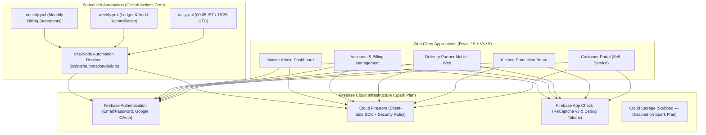

# Mysuru Paakashale ERP — Project Context

[← Back to Knowledge Base Hub](README.md) | [Business Rules](BUSINESS_RULES.md) | [Technical Architecture](TECHNICAL_ARCHITECTURE.md) | [Development Workflow](DEVELOPMENT_WORKFLOW.md) | [Current Status](CURRENT_STATUS.md) | [Decisions (ADRs)](DECISIONS.md)

---

## 1. Executive Summary & Mission
**Mysuru Paakashale** is a subscription-based and on-demand meal preparation and catering enterprise based in Mysuru (Karnataka, India). The ERP system manages the end-to-end lifecycle of meal subscriptions, daily kitchen production, delivery routing, customer invoicing, and administrative oversight.

The system is engineered as an AI-maintainable, serverless enterprise resource planning platform running entirely on the **Firebase Spark Plan (free tier)** with scheduled automation driven by **GitHub Actions** and real-time state mutation driven by **React web clients**.

---

## 2. High-Altitude System Architecture



### Dual Execution Architecture (Scheduled Batch vs. Intraday Client Mutations)
Operational execution operates across two coordinated layers:
1. **Scheduled Batch Pre-generation (00:05 IST):** A headless GitHub Actions cron job (`daily.yml`) executes at 00:05 [IST (Indian Standard Time, UTC+05:30)](#acronym-glossary). It reads active subscriptions, accounts for declared holidays and pre-scheduled pauses/skips, and writes the day's baseline order documents into Firestore.
2. **Real-Time Intraday Modifications (Pre-Cutoff):** Customers modifying meals intraday before strict meal cutoffs (e.g. modifying or skipping a lunch order before 10:30 IST or dinner before 16:00 IST) do **not** wait for a backend cron. The client-side React SPA directly calls `orderService.removeTodayMeal()` or `orderService.addTodayMeal()`, mutating the existing Firestore order document and updating the active invoice balance due in real time via the Firebase Client SDK under strict security rules.

---

## 3. Technology Stack

Versions verified against [package.json](file:///d:/mysuru-paakashale-ERP%20claude/package.json):

| Layer | Technology | Version | Purpose |
|---|---|---|---|
| **Language & Runtime** | TypeScript | `~6.0.2` | Strict type safety across client UI and backend automation |
| **Frontend Framework** | React + React DOM | `^19.2.8` | Component rendering, modern action hooks, and concurrency |
| **Build Tool & Bundler** | Vite + Vite-Node | `^8.1.1` / `^6.0.0` | Fast dev server, production bundling, and TypeScript script execution |
| **Styling & CSS** | Tailwind CSS | `^4.3.2` (`@tailwindcss/vite`) | CSS-first utility styling without legacy config file |
| **Iconography** | Lucide React | `^1.35.0` | Production icons for mobile and desktop dashboards |
| **State & Cache** | TanStack React Query | `^5.102.8` | Client caching, offline synchronization, and query invalidation |
| **Routing** | React Router DOM | `^7.18.2` | Declarative routing with role-based auth guards |
| **Database & Auth** | Firebase JS SDK | `^12.16.0` | Direct client-to-Firestore SDK, Auth, and App Check |
| **Admin Operations** | Firebase Admin SDK | `^14.2.0` | Test fixtures, emulator seed scripts, and admin tasks |
| **Linter & Static Analysis** | Oxlint | `^1.71.0` | High-performance lint verification in pre-commit and CI |
| **Testing Harness** | Vitest + Playwright | `^4.1.10` / `^1.62.1` | Unit tests, emulator integration tests, E2E browser automation |
| **Automation Engine** | GitHub Actions | Ubuntu Latest / Node 22 | Headless cron automation replacing Cloud Functions on Spark Plan |

---

## 4. The Five Application Roles & Permissions

Strict Role-Based Access Control (RBAC) is enforced at the database perimeter via `firestore.rules` and modeled as a discriminated union on `UserProfile.role` (`src/shared/types/user.types.ts`):

### 1. Customer (`role: "customer"`)
- **Capabilities:**
  - View meal plans, subscribe to recurring meal schedules, and configure preferences (dietary preferences, meal combinations).
  - Manage saved delivery addresses (`addresses[]` with flat `addressIds[]` synchronized for security rule evaluation).
  - Schedule temporary subscription pauses, resume subscriptions, and skip individual meals before strict cutoffs.
  - Submit manual payment transaction receipts/claims ([UTR numbers](#acronym-glossary), screenshot proofs) for administrative verification.
- **Access Boundary:** Restricted strictly to their own user profile (`/users/{uid}`), their own subscriptions (`/subscriptions/{subId}` where `customerId == uid`), and their own orders (`/orders/{orderId}` where `customerId == uid`).

### 2. Kitchen Staff (`role: "kitchen"`)
- **Capabilities:**
  - Real-time Production Board scoped by meal shift (Breakfast, Lunch, Dinner) and target date.
  - Advance orders through preparation lifecycle: `scheduled` → `preparing` → `packing` → `packed` → `ready_for_pickup`.
  - Batch recipe aggregation, ingredient totals, and dietary alert monitoring.
- **Access Boundary:** Scoped to assigned `kitchenId`. May read daily orders and update kitchen-stage statuses; cannot alter billing, invoices, customer subscriptions, or delete records.

### 3. Delivery Partner (`role: "delivery_partner"`)
- **Capabilities:**
  - Mobile web view of assigned delivery routes partitioned by meal shift.
  - Route sequencing (`routeSequence`) and delivery address navigation.
  - Handoff status updates: `picked_up` → `out_for_delivery` → `delivered` (or terminal failure: `failed_delivery`, `returned_delivery`).
  - Capture proof of delivery notes or delivery failure reason codes.
- **Access Boundary:** Read-only access to orders assigned to their `deliveryPartnerId` or within their assigned `zoneIds`. Update access restricted strictly to delivery status transitions and delivery timestamps.

### 4. Accounts Staff (`role: "accounts"`)
- **Capabilities:**
  - Invoicing oversight: review consumption-based invoices, invoice settlements, and manual credit adjustments.
  - Ledger audit: inspect immutable ledger entries (`/users/{customerId}/ledger/{entryId}`), transaction logs, and monthly reconciliations.
  - Payment auditing and accounts receivable tracking.
- **Access Boundary:**
  - **Read/Write Access:** `invoices` collection.
  - **Read-Only Access:** `payments` collection and `/users/{customerId}/ledger/{entryId}` subcollection (updates and payment verifications are restricted to Admin per `firestore.rules`).
  - Cannot modify kitchen production or delete customer profiles.

### 5. Admin (`role: "admin"`)
- **Capabilities:**
  - Master system governance: customer lifecycle management, staff creation, and role deactivation.
  - Delivery partner and zone assignments.
  - Holiday declaration and operational cancellations (`holidays/holiday_{date}`).
  - Manual payment verification/rejection (UTR approval workflow).
  - Failure queue triage (`failureQueue/{id}`) to resolve isolated automation warnings directly from the Admin SPA.
- **Access Boundary:** Administrative read/write access across all collections, subject to irreversible invariant constraints (e.g., hard deletion of orders is globally denied: `allow delete: if false;`).

---

## 5. Primary Business Workflows

### A. Subscription & Invoicing Lifecycle
1. Customer selects a meal plan, enters delivery addresses, and initiates a subscription in `draft` or `pending_payment` state.
2. The initial cycle invoice is created. The customer submits a payment transaction claim with their [UTR reference](#acronym-glossary) and optional receipt screenshot.
3. An Admin verifies the payment in the Admin Dashboard → subscription transitions to `active`.
4. During the active cycle, meals are consumed daily. If a customer skips or cancels an order prior to the shift cutoff, `billingService.adjustInvoiceForCancelledOrders()` immediately deducts the item cost from the current invoice balance due.
5. Invoices operate strictly on consumption: no wallet credits are generated, and historical wallet balances are preserved as read-only audit records ([ADR-002](DECISIONS.md#adr-002-elimination-of-wallet-credits-in-favor-of-pure-consumption-invoicing)).

### B. Daily Order Generation & Kitchen Dispatch
1. **00:05 IST Daily Cron** runs `orderService.generateDailyOrders(targetDate)` via GitHub Actions.
2. Checks for Sunday closure, declared holidays (`holidays/holiday_{date}`), customer pauses, and pre-scheduled meal skips.
3. Generates deterministic order documents (`ord_{subscriptionId}_{date}_{mealType}`) with items, delivery addresses, and customer display IDs (`MP-001`) frozen at snapshot time.
4. Intraday additions or skips prior to shift cutoffs are executed in real time by the customer web client.
5. Orders appear on Kitchen Production Board → Kitchen marks `ready_for_pickup` → Delivery partners pick up and deliver.

### C. Domain Concepts Explained
- **Meal Combinations:** Customer configuration options defining specific meal selections within a plan tier (e.g. South Indian vs North Indian curry choices, roti vs rice portion splits, or spice level preferences).
- **Tiffin Containers:** Reusable tiered stainless steel lunchbox sets (dabbas) used for hot meal delivery. Subscriptions may record a refundable container deposit (`depositStatus: "paid" | "refunded"`) held to ensure the physical return of tiffin hardware.

---

## 6. Acronym Glossary

- **UTR (Unique Transaction Reference):** A 12-to-22 digit financial identifier issued by Indian banks and payment gateways (NEFT, RTGS, IMPS, UPI) verifying a fund transfer.
- **UPI (Unified Payments Interface):** India's instant real-time payment system developed by NPCI, used for mobile payments and QR code transfers.
- **IST (Indian Standard Time):** UTC+05:30, the single operational timezone governing all order generation schedules, shift cutoffs, and delivery windows.
- **PWA (Progressive Web App):** Installable web application providing offline service worker caching and native-like mobile experience for delivery partners and kitchen staff.
- **IDOR (Insecure Direct Object Reference):** A security vulnerability where an unauthorized user accesses another user's data by tampering with document IDs in client requests; strictly prevented via `firestore.rules`.
- **RFC (Request For Comments):** Formal technical design proposal documents used to evaluate architectural changes before code implementation.
- **EGM (Elephant-Goldfish Model):** Dual-layer software engineering methodology pairing a persistent, long-term memory coordinator (Elephant) with ephemeral, fresh-context specialized review auditors (Goldfish).

---

## 7. Key Repository Directories

```text
├── .github/workflows/          # GitHub Actions CI, CD, and scheduled cron automations (daily, weekly, monthly)
├── docs/                       # Architectural documentation, operations runbooks, audit reports
│   └── project-context/       # Permanent verified project context (EGM bootstrap knowledge base)
├── scripts/
│   └── automation/            # Vite-Node backend automation scripts (daily.ts, weekly.ts, monthly.ts)
├── src/
│   ├── features/              # Domain feature modules (admin, auth, customer, delivery, kitchen, billing)
│   ├── shared/
│   │   ├── services/
│   │   │   ├── business/      # Domain business logic (orderService, billingService, subscriptionService)
│   │   │   └── firestore/     # Firestore data repositories (orderRepository, userRepository, etc.)
│   │   ├── types/             # Domain TypeScript interfaces and discriminated unions
│   │   └── lib/               # Firebase initialization, emulator configs, and utilities
│   └── test/                  # Test helpers, mocks, and fixture generators
├── tests/
│   └── security/              # Firestore security rules and IDOR emulator test suite
└── firestore.rules            # Canonical Cloud Firestore security rules
```
