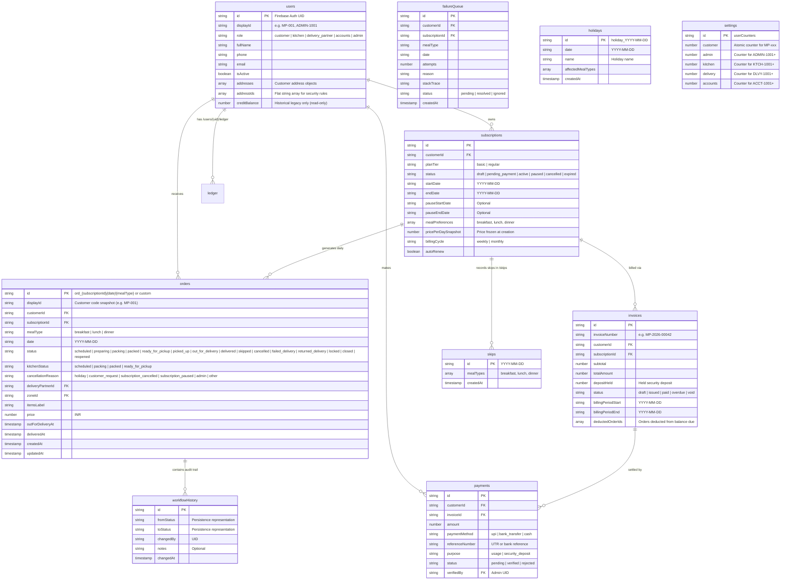

# Mysuru Paakashale ERP — Technical Architecture

[← Back to Knowledge Base Hub](README.md) | [Project Context](PROJECT_CONTEXT.md) | [Business Rules](BUSINESS_RULES.md) | [Development Workflow](DEVELOPMENT_WORKFLOW.md) | [Current Status](CURRENT_STATUS.md) | [Decisions (ADRs)](DECISIONS.md)

---

This document describes the software architecture, runtime boundaries, data schemas, infrastructure economics, and security design of the Mysuru Paakashale ERP system.

---

## 1. Architectural Philosophy & Infrastructure Constraints

### 1.1 Zero-Backend-Server Footprint (Firebase Spark Plan)
- **Spark Plan (Free Tier) Hosting:** The production database and authentication infrastructure operate entirely within Google Cloud's free Spark tier ([ADR-001](DECISIONS.md#adr-001-spark-plan-zero-server-infrastructure-via-github-actions)).
- **No Cloud Functions:** Traditional serverless microservices and background triggers are absent. All scheduled operations (order generation, billing reconciliation, pause/resume processing) run via scheduled **GitHub Actions cron runners** executing authenticated `vite-node` scripts.
- **Cloud Storage Disabled:** Google Cloud Storage is disabled on the Spark plan. Payment receipts and document proofs are handled via external proof URLs or compressed base64 strings. `src/shared/lib/firebase.ts` exports a null stub for `storage` to prevent runtime crashes.
  > [!WARNING]
  > **Base64 Storage Limit:** Storing uncompressed images directly in Firestore documents easily breaches Cloud Firestore's hard **1 MB document size limit**. Client upload components must compress or resize images client-side before submission.
- **Client-Side Enforcement via Security Rules:** Because backend APIs do not intermediate client writes, `firestore.rules` is the authoritative validation perimeter.

### 1.2 Infrastructure Economics & Quota Modeling
Operating on the Firebase Spark Plan (Google Cloud Standard Free Tier) requires disciplined awareness of resource ceilings:

| Resource Dimension | Official Spark Free Quota | Operational Impact & System Boundary |
|---|---|---|
| **Document Writes** | **20,000 writes / day** | Resets daily at **midnight US Pacific Time (00:00 PT)** (12:30 PM / 1:30 PM IST). A back-of-the-envelope calculation assuming ~17 writes per order lifecycle suggests an **unverified heuristic threshold of ~600 orders/day** before write exhaustion. Actual capacity depends on real-world workload modeling. |
| **Document Reads** | **50,000 reads / day** | Resets daily at midnight US Pacific Time. Background automation scripts must avoid unbounded collection scans and pass generated datasets in-memory to verification services. |
| **Document Deletes** | **20,000 deletes / day** | Resets daily at midnight US Pacific Time. Orders are immutable (`allow delete: if false;`), keeping delete consumption near zero. |
| **Database Storage** | **1 GiB total stored data** | Covers active operational documents. Storage growth must be monitored; an external archival dump and purge policy for historical data is currently under proposal ([ADR-007](DECISIONS.md#adr-007-strict-order-immutability--archival-policy)). |
| **Network Egress** | **10 GiB / month** | Outbound data transfers from Firestore client queries. |
| **Sustained Document Write Rate** | **~1 sustained write / sec** | Official Google Cloud Firestore guidance recommends a sustained write rate limit of ~1 write per second to an individual document to avoid lock contention and latency spikes (bursts up to 500/sec supported). Handled in `userRepository.ts` via exponential backoff retries ([ADR-003](DECISIONS.md#adr-003-sequential-customer-display-ids-mp-001-mp-002-via-atomic-counters)). |

#### Proposed Optimizations (Under Architectural Evaluation)
- **Subcollection-to-Array Optimization (Proposed):** Evaluates embedding `statusHistory: []` as an array directly on the parent `Order` document rather than writing to `orders/{id}/workflowHistory/{historyId}` subdocuments. This could reduce order lifecycle writes by ~40%, but remains a proposal pending load verification.
- **Historical Data Archiving (Proposed):** Evaluates periodically exporting orders older than 180 days to external cold storage (NDJSON / Google Drive / local disk) to keep database storage well beneath the 1 GiB limit. Immutability remains the active approved policy.

---

## 2. Component Architecture & Module Decomposition

```text
src/
├── features/                  # Domain Feature Modules
│   ├── accounts/              # Invoices, ledger audit, reconciliation, billing dashboard
│   ├── admin/                 # Customer directory, menu setup, failure queue, staff management
│   ├── analytics/             # Reporting, meal forecasting, KPI dashboards
│   ├── auth/                  # Login, registration, session management, AuthContext
│   ├── customer/              # Customer portal, address manager, skip/pause modal
│   ├── dashboard/             # Role-based landing dashboard routers
│   ├── delivery/              # Delivery partner route sequencing, shift manager
│   ├── hr/                    # Staff records, attendance, payroll calculations
│   ├── kitchen/               # Production Board, batch prep summaries, dispatch
│   └── notifications/         # Notification tray, SMS/in-app dispatching
├── shared/
│   ├── lib/                   # Firebase initialization, date helpers (Asia/Kolkata)
│   ├── services/
│   │   ├── business/          # Core orchestration services (orderService, billingService)
│   │   ├── email/             # Transactional email dispatch stubs
│   │   ├── firestore/         # BaseRepository<T>, orderRepository, userRepository
│   │   └── storage/           # Payment proof upload stubs
│   ├── types/                 # Canonical TypeScript models and discriminated unions
│   └── utils/                 # Allotted ID formatting, PDF generators, calculations
```

---

## 3. Cloud Firestore Data Schema



---

## 4. Contract Separation: Public Domain vs Persistence Schema

A critical design pattern enforced in the repository layer (as refined in PR #165) is the boundary separation between **Firestore Persistence Representation** and the **Public Domain Model**:

### 4.1 Workflow History Contract Separation
- **Stored in Firestore (`orders/{orderId}/workflowHistory/{historyId}`):**
  ```typescript
  interface PersistedWorkflowHistoryDoc {
    fromStatus: OrderStatus;
    toStatus: OrderStatus;
    changedBy: string;
    changedAt: Timestamp;
    notes?: string | null;
  }
  ```
- **Returned to Application Consumers (`src/shared/types/order.types.ts`):**
  ```typescript
  export interface OrderWorkflowHistory {
    id: ID;
    previousStatus: OrderStatus;
    newStatus: OrderStatus;
    changedBy: ID;
    changedAt: Timestamp;
    notes?: string; // Optional string, never null
  }
  ```
- **Mapper Guarantee in `orderRepository.getWorkflowHistory()` and `orderRepository.subscribeWorkflowHistory()`:** Shared mapper `mapWorkflowHistoryDoc` canonicalizes `fromStatus` → `previousStatus` and `toStatus` → `newStatus`. It normalizes stored `notes: null` to `undefined`, preventing internal database property names from leaking into domain interfaces for both one-time fetches and real-time snapshot subscriptions.

---

## 5. Security Rules & Access Control Perimeter

The application’s security rules (`firestore.rules`) enforce authorization through helper functions evaluated on the authenticated user profile document (`users/{request.auth.uid}`):

```text
isAdmin()            -> role == 'admin' && isActive()
isCustomer()         -> role == 'customer'
isKitchen()          -> role == 'kitchen' && isActive()
isDeliveryPartner()  -> role == 'delivery_partner' && isActive()
isAccounts()         -> role == 'accounts' && isActive()
```

### Key Security Safeguards:
1. **Flat `addressIds[]` Array Synchronization:** Cloud Firestore Security Rules cannot iterate or query inside arrays of nested map objects. User profiles maintain a synchronized flat array `addressIds: string[]` so rules can execute:
   ```text
   request.resource.data.deliveryAddressId in callerDoc().addressIds
   ```
2. **Soft-Deleted Staff Lockdown:** All staff helper functions evaluate `isActive() == true`. Deactivated staff immediately lose permission to write to Firestore even if their Firebase Auth token is unexpired.
3. **Accounts Role Read-Only Boundaries:** In `firestore.rules`, Accounts staff has read/write permissions on `invoices`, but strictly **read-only** permissions on `payments` and `/users/{userId}/ledger/{entryId}` (write and approval actions require `isAdmin()`).
4. **Universal Delete Prohibition on Orders:** `allow delete: if false;` applies to all orders across all roles.
5. **Cutoff Timezone Alignment:** `checkMealsCutoff` in `firestore.rules` computes base timestamps using `timestamp.date()`, which initializes at `00:00:00 UTC` (`05:30:00 AM IST`). Offsets (`-30m` for breakfast, `+5h` for lunch, `+10h 30m` for dinner) correspond precisely to `05:00 IST`, `10:30 IST`, and `16:00 IST`. This mathematically mirrors `AUTHORITATIVE_OPERATIONAL_CUTOFFS` evaluated by client code in `dateUtils.ts`, ensuring zero temporal skew between client UX and database rule enforcement.

---

## 6. Failure Quarantine Architecture (`failureQueue`)

To prevent automated background tasks (daily cron) from crashing or locking up the entire kitchen when a single customer profile is misconfigured:
- The system employs a **Quarantine Architecture**:
  - If a single subscription or billing record encounters an error, the exception is isolated, quarantined, and recorded in `failureQueue/{id}` with complete debugging metadata (`customerId`, `subscriptionId`, `reason`, `stackTrace`).
  - The remaining healthy customer subscriptions continue uninterrupted.
  - The Admin Dashboard features a dedicated **Admin Failure Queue** page where administrators review quarantined records and re-trigger processing for that specific entity directly from the Admin React client.
